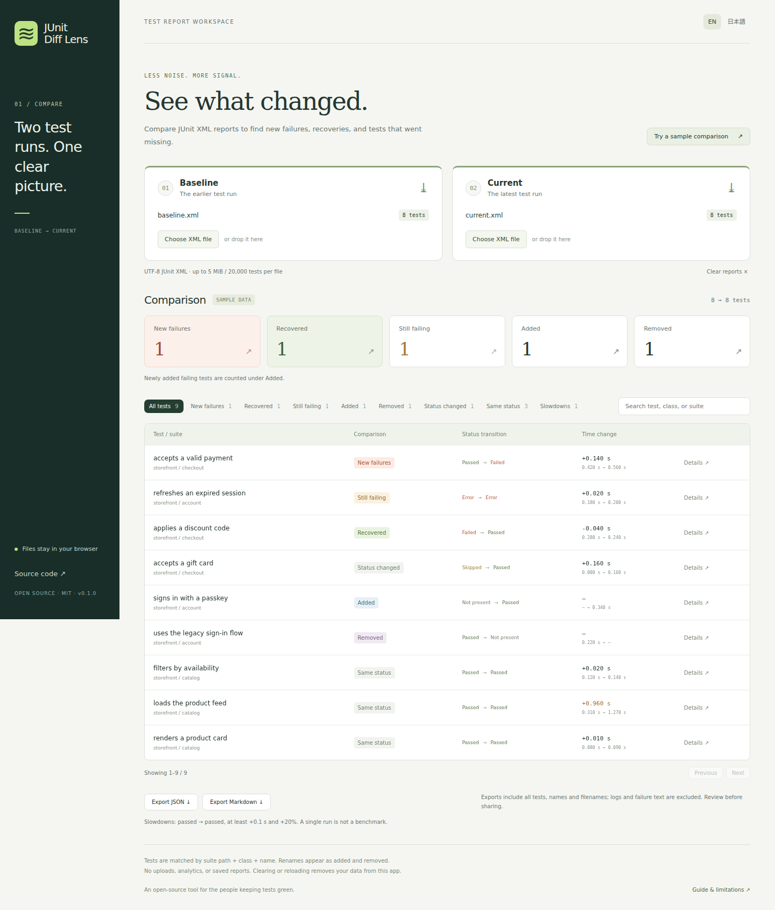

# JUnit Diff Lens

**Find new failures, recoveries, and missing tests between two JUnit XML reports — in your browser.**

[Open the app](https://tomdachs.github.io/junit-diff-lens/) · [Download a release](https://github.com/Tomdachs/junit-diff-lens/releases) · [日本語](docs/README.ja.md)

For maintainers reviewing a failing CI run, upgrading a dependency, or comparing a branch against a baseline. Load two files or click **Try a sample comparison**. No account, CI integration, or upload is required.



## Quick start

Open **[JUnit Diff Lens](https://tomdachs.github.io/junit-diff-lens/)**, select a **Baseline** XML and a **Current** XML, and inspect **New failures**. The **Slowdowns** view highlights timing increases between passing tests. Select **Details** to read a failure message.

For local/offline use, download and extract `junit-diff-lens-v0.1.0.zip` from the release, then run this command in the extracted directory:

```sh
python3 -m http.server 8080 --bind 127.0.0.1
```

Open `http://127.0.0.1:8080`. All assets are included; Node.js is not needed to use the release. On Windows, `py -m http.server 8080 --bind 127.0.0.1` is equivalent. The hosted app also keeps working if disconnected **after loading**; offline reload of the hosted site is not guaranteed.

## What it does

- Compares standard JUnit `testsuite` / `testsuites` XML, including nested suites.
- Separates new failures, recoveries, persistent failures, added/removed tests, and other status changes.
- Searches by test, class, or suite; shows at most 50 rows per page.
- Shows testcase durations and a slowdown view (both runs passed, at least +0.1 seconds **and** +20%).
- Exports the **entire** comparison as versioned JSON or Markdown, regardless of filters.
- Provides English and Japanese interfaces with keyboard-accessible inputs and controls.

Example report producers include `pytest --junitxml=report.xml`, Maven Surefire, and Playwright's JUnit reporter. Compatibility is defined by the XML contract below; the app does not implement every producer's extensions.

## Comparison contract and limits

| Rule                 | Behavior                                                                                                                                                    |
| -------------------- | ----------------------------------------------------------------------------------------------------------------------------------------------------------- |
| Test identity        | Exact, case-sensitive tuple of suite path, `classname`, and `name`. Order is irrelevant. Renames appear as added/removed.                                   |
| Duplicates           | Rejected. Compare one shard/run at a time or fix ambiguous producer identities. No silent overwriting.                                                      |
| Recovery             | Failure/error → passed only. A skipped or missing test is not a recovery.                                                                                   |
| Added failures       | Classified as Added with a Failed marker; not counted as regressions of existing tests.                                                                     |
| Standard statuses    | `error` > `failure` > `skipped` > passed. Conflicting markers produce a warning.                                                                            |
| Counters             | Derived from individual testcases. Producer aggregate `tests`/`failures` counters are not trusted.                                                          |
| Durations            | Nonnegative finite testcase seconds; missing/invalid values are unknown, not zero. These are not CI wall-clock durations or statistical performance claims. |
| Retry extensions     | Warned about; only the final standard status is compared. Flakiness cannot be inferred from two files.                                                      |
| Suite-level failures | Warning to inspect the original XML. Not represented as a fabricated testcase.                                                                              |
| Limits               | One file per side, UTF-8 only, 5 MiB, 20,000 testcases, suite nesting up to 32 levels. Large files can briefly pause the tab.                               |
| Excluded formats     | ZIP archives, TRX, NUnit XML, Open Test Reporting XML, attachments, and live CI connections.                                                                |

The parser uses the browser's inert XML parser. DTD/entity declarations are rejected, and failure content is rendered as plain text. Namespaces on standard elements are accepted. Supported structure: root `testsuite` or `testsuites`, nested suites, and direct `testcase` children of suites. `properties`, `system-out`, and `system-err` are not retained. Reports with no testcases are explicitly noted.

## Privacy

Reports live only in this tab's memory. There are no uploads, analytics, cookies, local storage, external fonts, or API keys. **Clear reports** or reload to remove them from application state. Your original files are unchanged. GitHub Pages still receives ordinary requests for the site and static assets. Use the release on localhost when you need to avoid that connection.

Exports include test/suite/class names and filenames, which may be sensitive. They exclude failure messages and raw logs but are **not** an anonymization tool. Review exported files before sharing. Browser extensions, downloads, and screenshots are outside the app's control.

## Development and validation

Use Node.js 24 (also used in CI):

```sh
npm ci
npx playwright install --with-deps chromium
npm run check
```

`npm run check` runs parser/comparison tests, TypeScript checks, the production build, and browser journeys at desktop and mobile sizes. The journeys check offline comparisons, no outgoing report requests, file replacement errors, pagination, exports, literal failure rendering, Japanese UI, and clearing/reloading.

`npm run dev` starts a localhost development server. The production CSP also applies in development, so Vite's websocket hot reload is blocked; manually reload after edits. `npm run preview` serves the production build at `127.0.0.1:4173`.

## Why a separate tool?

[JUnitDiff](https://github.com/heiglandreas/JUnitDiff) and [junit-xml-diff](https://github.com/insightsengineering/junit-xml-diff) offer command-line comparisons. [junit-time-diff](https://github.com/mauvilsa/junit-time-diff) supports multi-run timing analysis. [junit2html](https://gitlab.com/inorton/junit2html) generates HTML reports, and [Test Reporter](https://github.com/dorny/test-reporter) integrates with GitHub Checks. Prefer those when you need their automation or reporting features.

Diff Lens focuses on a small workflow: **open two downloaded reports, triage changes locally, and export a summary**. It does not need repository access or a CI configuration change. It is independently implemented; no competitor code is bundled.

## Contributing and releases

See [CONTRIBUTING.md](CONTRIBUTING.md), [SECURITY.md](SECURITY.md), and the [release procedure](docs/releasing.md). Bug reports with minimal, synthetic XML fixtures are particularly useful. MIT licensed; runtime dependencies React and React DOM are MIT licensed too. Release archives include their license notices.
